# toauner

> 곡을 찾는 순간부터, 실제 기타를 안정적으로 맞추는 순간까지의 흐름을 하나로 설계한 정밀 기타 튜너.

`toauner`는 Android/iOS용 Flutter 기타 튜너이자, **오디오 신호 처리·음악 도메인 모델링·모바일 제품 설계**를 함께 다룬 포트폴리오 프로젝트입니다. 단순히 현재 음을 표시하는 크로매틱 튜너를 넘어, 사용자가 “이 곡은 어떤 튜닝이지?”에서 출발해 맞는 현을 인식하고, 조율 방향을 이해하고, 셋업 상태를 점검할 때까지의 실제 기타 연주 흐름을 다룹니다.

> **개발 상태**: 정밀 측정 코어와 주요 제품 흐름을 구현·테스트하는 단계입니다. 성능 수치는 합성 신호, 녹음 WAV, 실제 기기 라이브 입력을 분리해 검증하며, 검증되지 않은 실기기 정확도를 홍보 문구로 사용하지 않습니다.

## Android 다운로드

Android 사용자는 [SharkTune-Android-1.0.0.apk](https://github.com/halfsamoan/shark_tuner/releases/download/v1.0.0/SharkTune-Android-1.0.0.apk)를 내려받아 설치할 수 있습니다. 설치 시 파일을 연 앱에 대해 `알 수 없는 앱 설치` 권한을 허용하고, 처음 실행할 때 마이크 권한을 승인하세요.

GitHub Release에는 APK의 SHA-256 체크섬과 설치 안내도 함께 제공합니다. iOS는 Apple 서명과 배포 절차가 필요하므로 이 릴리스에 포함하지 않습니다.

## 포트폴리오 한눈에 보기

| 영역 | 내가 해결한 문제 | 구현한 접근 |
| --- | --- | --- |
| 제품 흐름 | 곡을 알아도 필요한 튜닝으로 가는 과정이 분리되어 있음 | 곡 검색 → 버전 있는 `TuningDefinition` 스냅샷 → 즉시 정밀 튜닝 |
| 저음현 검출 | 강한 배음과 약한 기음 때문에 옥타브 오류가 생김 | MPM 기반 검출, 보수적 옥타브 보정, 저튜닝 전용 분석 창 |
| 신뢰성 | 모바일 녹음 경로가 기기마다 다르고 무음/처리된 입력이 발생함 | Android `UNPROCESSED` 우선, PCM RMS 검증 후 `VOICE_RECOGNITION` 폴백 |
| 피드백 | 한 프레임의 흔들림이 바늘과 현 선택을 계속 바꿈 | clarity gate → median-of-five → cents-domain EMA → in-tune hysteresis |
| 초보자 지원 | “올려라/내려라”를 실제 페그 회전으로 번역하기 어려움 | 헤드스톡 구조를 진리표로 모델링하고, 관측과 다르면 안내를 멈춤 |
| 셋업 판단 | 불안정한 조율을 단일 원인으로 단정하기 쉬움 | pluck별 관측값과 신뢰도에 기반한 확률적 가설 제시 |

## 다른 튜너 경험과 다른 점

많은 크로매틱 튜너는 `음 이름 + cent 오차`를 정확히 보여주는 데 집중합니다. toauner는 그 정보를 출발점으로 삼고, **조율을 끝낼 수 있는 의사결정**까지 제품 범위를 넓혔습니다.

| 구분 | 일반적인 크로매틱 튜너 흐름 | toauner의 설계 |
| --- | --- | --- |
| 시작점 | 사용자가 원하는 튜닝을 이미 알고 있다고 가정 | 곡명/아티스트 검색으로 튜닝·카포·현 수·검증 상태 확인 |
| 저음 튜닝 | 기본 창 크기에서 모든 현을 동일하게 처리하기 쉬움 | 최저 목표음이 80 Hz 미만이면 8,192-sample 저튜닝 경로로 전환 |
| 음 안정화 | 값이 흔들리면 단순 평균 또는 표시 지연 | 신뢰도·옥타브·시간 연속성을 분리한 다단계 안정화 |
| “맞음” 판정 | 특정 순간의 허용 오차 | 새 피킹의 빠른 성공 경로와 지속 유지 경로를 함께 사용 |
| 페그 안내 | 음정을 높이거나 낮추라는 추상적인 안내 | 악기 구조와 줄 감김을 반영한 회전 방향, 모순 관측 시 사용자 확인 |
| 현/셋업 | 튜닝 결과와 분리된 참고 정보 | 장력·게이지·스케일 길이와 안정성 진단을 같은 튜닝 문맥에서 제공 |

이 비교는 다른 제품 전체를 일반화한 평가가 아니라, toauner가 해결 대상으로 정한 사용자 경험의 차이를 설명합니다.

## 제품 시나리오

1. 사용자가 곡명 또는 아티스트를 검색한다.
2. 곡의 튜닝, 카포, 현 수, 출처·검증 상태를 보고 `이 곡으로 튜닝`을 선택한다.
3. 화면은 문자열 이름이 아니라 불변의 `TuningDefinition` 식별자와 스냅샷을 전달받는다. 따라서 검색 결과가 바뀌어도 진행 중인 조율 세션의 목표음은 흔들리지 않는다.
4. 실시간 엔진은 실제로 들린 현, Hz, cent 편차, 조정 방향, 신뢰도, 잠금 상태를 제시한다.
5. 조율이 반복해서 불안정하면 사용자는 같은 튜닝 문맥에서 장력/게이지 추천과 안정성 점검으로 이어갈 수 있다.

이 흐름의 핵심은 “음정을 보여 주는 앱”이 아니라 **노래를 연주할 준비를 끝내는 앱**으로 문제를 정의한 점입니다.

## 신호 처리 파이프라인

```mermaid
flowchart LR
    A["마이크 PCM16 mono"] --> B["입력 경로 검증\nUNPROCESSED → RMS probe → fallback"]
    B --> C["DSP isolate\nring buffer · onset tracker"]
    C --> D["MPM detector\nFFT autocorrelation → NSDF"]
    D --> E["clarity gate\nweak estimate rejection"]
    E --> F["octave sanity\ntarget / previous-stable anchor"]
    F --> G["median-of-five\nlog-frequency EMA"]
    G --> H["physical string selection\nin-tune lock"]
    H --> I["Hz · cents · peg guidance\nstability evidence"]
```



### 1. 캡처 경로부터 정확도를 보장한다

정확한 검출기는 입력이 망가져 있으면 정확할 수 없습니다. Android에서는 다음 정책을 구현했습니다.

- **48 kHz, mono PCM16**을 요청하고 AGC, echo cancellation, noise suppression을 끕니다. 음성 통화용 처리보다 원래의 기타 파형을 우선합니다.
- `UNPROCESSED` 입력을 먼저 요청합니다. 일부 OEM에서 이 경로가 all-zero PCM을 주는 문제를 고려했습니다.
- 처음 약 4,800개 샘플을 검사해 최소 비영(非零) 샘플 수와 RMS가 **-90 dBFS 이상**인지 확인합니다. 무음이거나 신호가 너무 작으면 해당 경로를 폐기합니다.
- 검증에 실패하면 `VOICE_RECOGNITION` 입력으로 폴백하고, 런타임이 실제로 제공한 sample rate를 DSP에 전달합니다.
- DSP는 Flutter UI isolate가 아니라 별도 isolate에서 실행합니다. UI 프레임과 지속적인 분석 비용을 분리한 구조입니다.

이 선택은 “마이크 권한을 얻었다”와 “측정에 쓸 수 있는 PCM을 얻었다”를 다르게 취급한 것입니다.

### 2. 기타 저음현을 위한 MPM 피치 검출

핵심 검출기는 논문에 기술된 McLeod Pitch Method(MPM)를 바탕으로 한 **클린룸 Dart 구현**입니다. GPL 구현체를 가져오거나 포팅하지 않고, 수식과 동작 원리에 따라 새로 구성했습니다.

#### 처리 과정

1. 프레임의 평균을 빼 DC offset을 제거하고 RMS가 충분한지 확인합니다.
2. FFT로 자기상관을 계산하고, 원형 상관의 경계 항을 보정해 선형 상관을 복원합니다.
3. 각 lag `τ`에 대해 normalized square difference function을 계산합니다.

   ```text
   NSDF(τ) = 2 · autocorrelation(τ) / overlapping-energy(τ)
   ```

4. 양의 lobe마다 하나의 local maximum만 후보로 모읍니다. 가장 강한 peak의 93% 이상이면서 clarity 0.8 이상인 **가장 이른** 후보를 고릅니다.
5. 3점 포물선 보간으로 정수 lag 사이를 보정한 뒤, `frequency = sampleRate / period`로 Hz를 계산합니다.

초기 peak 하나만 고르는 방식은 저음현에서 강한 2·3배음으로 인한 옥타브 오류에 취약합니다. toauner는 “충분히 강한 가장 이른 주기”를 고르는 MPM 후보 정책과 후단의 옥타브 sanity check를 함께 사용합니다. 검출기가 돌려주는 clarity는 이후 신뢰도 gate에도 재사용합니다.

#### 분석 창과 업데이트 설계

| 경로 | 분석 창 | hop | 요청 sample rate 기준 명목 분석 빈도 | 의도 |
| --- | ---: | ---: | ---: | --- |
| 일반 튜닝 | 4,096 samples | 1,536 samples | 31.25 Hz | 일반 기타 현에서 반응성과 안정성의 균형 |
| 저튜닝 | 8,192 samples | 2,400 samples | 20 Hz | Drop/확장현처럼 긴 주기가 필요한 입력 |

지원 검출 하한은 **43 Hz**입니다. 최저 목표음이 80 Hz 미만이면 저튜닝 경로를 선택합니다. FFT plan과 typed scratch buffer는 프레임마다 새로 만들지 않고 재사용합니다. 이 때문에 긴 창을 쓰더라도 할당 압박과 UI 간섭을 줄일 수 있습니다.

### 3. “값을 내는 것”보다 “틀린 값을 내지 않는 것”을 우선한다

실시간 튜너에서 거짓 양성은 단순한 노이즈보다 위험합니다. 사용자는 화면의 방향 안내를 따라 실제 줄 장력을 바꾸기 때문입니다. toauner의 추적 경로는 다음 순서로 동작합니다.

1. **Clarity gate**: 기본적으로 clarity 0.9 미만 프레임은 신뢰하지 않습니다.
2. **제한적 target-assisted recovery**: 0.81 이상이면서 현재 튜닝의 물리적 목표음 중 하나에서 75 cents 이내인 경우에만 낮은 confidence를 제한적으로 수용합니다. 목표와 무관한 소음은 살려 두지 않습니다.
3. **보수적 옥타브 보정**: raw 주파수의 `1/2`, `1/3`, `2배` 후보를 만듭니다. 현재 목표음 또는 직전 안정값에 대해 **75 cents 이내**이고, raw 값보다 충분히 개선될 때만 보정합니다. 특히 cold start에서는 실제로 한 옥타브 낮게 조율된 줄을 잘못 덮어쓰지 않도록 높은 배음을 아래로 접는 경우만 허용합니다.
4. **Median-of-five**: 단발성 outlier와 순간적인 배음 점프를 제거합니다.
5. **log-frequency EMA**: 주파수 대신 cents 공간에서 α=0.3으로 평활화합니다. 같은 음악적 간격이 같은 가중치를 받아, 저음과 고음에서 일관된 시각적 안정성을 얻습니다.
6. **history reset**: 신뢰할 수 없는 프레임이 3회 연속되면 이전 안정값을 버립니다. 예전 음이 새 피킹 위에 남지 않습니다.

### 4. 현 자동 선택과 in-tune 잠금은 별도 상태기계다

자동 현 선택은 단순히 가장 가까운 음을 매 프레임 표시하지 않습니다. 현재 현보다 다른 현이 **25 cents 이상 더 가까워야** 하고, 새 피킹 이후 **2개 프레임의 반복 증거**가 있어야 바뀝니다. 지속음의 배음이 다른 현처럼 보이는 문제를 줄이기 위한 장치입니다.

“맞음” 판정도 한 번의 프레임으로 끝내지 않습니다.

- 새 피킹 뒤 1초 안에 ±2 cents에 들어오면 즉시 lock합니다. 사용자가 원하는 빠른 성공 경로입니다.
- 그 기회를 놓치면 ±3 cents 범위를 750 ms 유지해야 lock합니다.
- lock된 뒤에는 ±5 cents의 더 넓은 release tolerance와 최대 2개 프레임의 짧은 dropout 허용으로 표시가 깜빡이지 않게 합니다.
- beginner/pro 모드는 허용 오차 구성을 바꿀 수 있어, 정밀도와 학습 난이도를 하나의 고정값으로 강요하지 않습니다.

## 음악·물리 도메인 로직

### 곡 데이터: 텍스트 이름 대신 버전이 있는 튜닝 정의

곡 검색 결과에는 탭이나 가사를 저장하지 않습니다. 자체 큐레이션한 곡명, 아티스트, 튜닝, 카포, 현 수, 출처와 검증 상태를 관리합니다. 조율 화면으로는 표시 문자열이 아니라 id·버전·불변 문자열 목록을 가진 `TuningDefinition` 스냅샷이 전달됩니다.

이 설계는 데이터 수정 이후에도 진행 중인 세션의 기준음을 재현할 수 있게 하고, “곡 제목이 같은데 튜닝이 달라졌다”는 데이터 품질 문제를 추적 가능하게 만듭니다.

### 페그 방향: 조건문이 아니라 검증 가능한 진리표

“시계 방향으로 돌리세요”는 헤드스톡 종류와 줄 감김에 따라 쉽게 틀릴 수 있습니다. 그래서 오른손/왼손, 정방향/리버스 헤드스톡, bass/treble side, 줄 감김 방향, inline/split/classical 구조를 데이터 모델로 분리했습니다.

기본 규칙과 실제 관측이 두 번 연속 모순되면 앱은 안내를 계속 밀어붙이지 않고 멈춘 뒤 반대 방향 제안을 합니다. 사용자가 수락하면 해당 페그의 override를 저장합니다. 클래식 기타의 slotted roller처럼 기본 규칙만으로 안전하게 말할 수 없는 구조는 **검증된 개별 override가 없으면 방향을 출력하지 않습니다.**

### 장력·게이지: 추천의 근거를 노출한다

현 장력은 다음 식으로 계산합니다.

```text
T = UW × (2 × L × F)² / 386.4
```

- `T`: 장력(lbf)
- `UW`: unit weight(lb/in)
- `L`: 스케일 길이(in)
- `F`: 목표 주파수(Hz)

plain string은 게이지와 강철 밀도에서 unit weight를 유도할 수 있지만, wound string은 구조 차이 때문에 임의 추정을 허용하지 않습니다. 측정 또는 fitted unit weight와 출처가 없으면 계산을 거부합니다. 멀티스케일 기타는 저음현에서 고음현으로 스케일 길이를 보간하고, 결과를 floppy / comfortable / firm / tight band로 나눕니다.

### 안정성 진단: 원인 단정 대신 관측과 가설을 분리한다

한 번의 피킹으로 “너트 마찰”을 단정하는 대신, 각 pluck에서 다음을 추출합니다.

- attack overshoot
- settle time
- steady-state drift(cents/s)
- 조정 이후 step jump
- peak RMS, clarity, valid-frame ratio

신뢰도 0.9 이상이고 유효 프레임 비율이 0.7 이상인 pluck이 최소 3개 있어야 평가합니다. 이후에도 결과는 `possibleLightGaugeOrHeavyAttack`, `possibleNutFriction`, `possibleNewStringStretch`처럼 **가능성**으로 표현합니다. 5회 이상 같은 현을 측정했을 때에는 피킹 세기 차이를 RMS로 정규화한 overshoot 변동계수도 기록합니다.

## 성능 설계와 검증 원칙

정확도는 하나의 숫자로 광고하지 않습니다. toauner는 아래 세 계층을 구분합니다.

| 검증 계층 | 입력 | 보는 지표 | 현재 역할 |
| --- | --- | --- | --- |
| S1: 합성 신호 | 48 kHz sine, 43–1,318 Hz, ±3/17/49 cents offset | median·p95·max cent error, no-estimate, octave error | CI에서 결정적 알고리즘 회귀를 막는 gate |
| G1: 실제 기타 WAV | DI 또는 교정된 레퍼런스 녹음 | 일반 현/저음현별 오차와 octave error | 실기타 음색에 대한 측정 gate |
| D1: 실제 모바일 기기 | 라이브 마이크 입력 | 입력 경로, p95 error, first-valid-estimate 지연 | OEM/기기별 현장 검증 |

S1 합격 기준은 두 분석 창 각각에서 다음을 모두 만족하는 것입니다.

- median absolute error ≤ **0.5 cent**
- p95 absolute error ≤ **1 cent**
- maximum error ≤ **1 cent**
- no-estimate = **0**, octave error rate = **0**

이는 **합성 신호의 수락 기준**이지, 모든 휴대폰·모든 기타·모든 소음 환경에서의 제품 정확도 주장이 아닙니다. 실제 기타 WAV와 라이브 기기 결과는 별도로 보고하도록 설계했습니다. 정확도 규격과 보고 명령은 [docs/accuracy-spec.md](docs/accuracy-spec.md)에 있습니다.

### 최신 S1 실행 결과

2026-07-22에 현재 코드로 합성 코퍼스를 실행했습니다. 각 행은 52개 주파수/offset 입력을 평가한 결과이며, 아래 `elapsed`는 개발 머신에서 코퍼스 전체를 처리한 시간입니다. 라이브 입력 지연이나 모바일 CPU 사용량을 뜻하지 않습니다.

| 분석 창 | estimates | median absolute error | p95 absolute error | maximum error | octave / no-estimate | corpus elapsed |
| ---: | ---: | ---: | ---: | ---: | ---: | ---: |
| 4,096 samples | 52/52 | 0.000507 cents | 0.010308 cents | 0.028996 cents | 0 / 0 | 78 ms |
| 8,192 samples | 52/52 | 0.000195 cents | 0.009289 cents | 0.022769 cents | 0 / 0 | 63 ms |

두 경로 모두 S1 gate를 통과했습니다. 이 결과는 이상적인 합성 sine에서의 detector 정확도이며, 실제 기타·기기 입력의 결과와 의도적으로 분리합니다.

또한 제품 로드맵에는 실제 기기에서 첫 유효 추정 p95 150 ms 이하와 steady-state DSP CPU 한 코어 20% 이하를 **측정 목표**로 두고 있습니다. 아직 측정 결과가 아닌 목표를 실측 성능처럼 표현하지 않는 것이 이 프로젝트의 검증 원칙입니다.

## 아키텍처

```text
app/                        Flutter 화면, 세션 조립, DSP isolate 경계
packages/tuner_audio/       AudioCapture 추상화와 Android/iOS 캡처 정책
packages/tuner_dsp/         Flutter 비의존 MPM, 추적·안정화, 정확도 도구
packages/tuner_domain/      튜닝, 현 선택, 페그, 장력, 안정성의 순수 도메인 로직
packages/tuner_data/        곡/튜닝 모델, 로컬 저장소, 검색 데이터
packages/tuner_dsp_native/  추후 FFI 구현을 위한 선택적 어댑터 경계
data/songs/                 출처를 기록한 자체 큐레이션 메타데이터
```

교체 경계는 `PitchDetector`와 `AudioCapture` 두 개입니다. 이 덕분에 Dart DSP와 향후 네이티브 DSP를 동일한 테스트 코퍼스로 비교하거나, Android/iOS/테스트 오디오 소스를 UI 수정 없이 교체할 수 있습니다.

## 품질 보증

- DSP, 도메인, 오디오 어댑터는 Flutter UI와 분리해 작은 결정적 테스트를 유지합니다.
- MPM의 FFT 경로는 직접 계산한 시간 영역 MPM 참조와 대조합니다.
- 약한 기음·강한 배음, 무음, NaN 입력, octave correction, median/EMA, 자동 현 전환, in-tune hysteresis를 각각 테스트합니다.
- 페그 진리표의 모든 구조 조합, 조정 방향 모순 감지, wound unit weight 출처 요구, 안정성 진단의 “증거 부족” 경로를 테스트합니다.
- 빌드 전 포맷·정적 분석·워크스페이스 테스트·합성/실기타/public corpus 보고를 실행하도록 [tool/check.ps1](tool/check.ps1)을 구성했습니다.

## 로컬 실행 및 검증

PowerShell에서 Flutter SDK와 Pub workspace를 준비합니다.

```powershell
.\tool\bootstrap.ps1
```

포맷, 분석, 테스트, 정확도 보고를 실행합니다.

```powershell
.\tool\check.ps1
```

합성 신호 S1 결과만 빠르게 다시 확인하려면 다음을 실행합니다.

```powershell
Set-Location packages\tuner_dsp
& ..\..\.tools\flutter\bin\dart.bat run tool\synthetic_accuracy_report.dart
```

## 제출용 요약

toauner는 Flutter 앱 하나를 만드는 데서 멈추지 않고, **실제 기타의 저음·배음·기기별 오디오 입력·물리적 조율 동작**이 만나는 지점을 시스템으로 설계한 프로젝트입니다. 핵심 기여는 다음과 같습니다.

1. MPM을 클린룸으로 구현하고, FFT 기반 자기상관·포물선 보간·배음/옥타브 방어를 결합한 저음현 피치 검출 파이프라인을 설계했습니다.
2. 신뢰도 gate, target-aware recovery, median/EMA, hysteresis를 서로 다른 실패 모드에 맞춰 분리해 “그럴듯하지만 틀린 값”의 사용자 영향을 줄였습니다.
3. OEM 오디오 경로의 실패를 PCM sanity probe와 fallback 정책으로 다루고, 지속 DSP 처리를 isolate로 격리했습니다.
4. 페그 방향, 현 장력, 튜닝 안정성처럼 오디오 신호 밖의 실제 연주 문제를 검증 가능한 도메인 모델과 보수적인 UI 언어로 연결했습니다.
5. 합성 신호·실기타 녹음·실제 모바일 입력을 구분한 검증 체계를 두어, 정확도 수치를 과장하지 않고 재현 가능한 결과로 관리했습니다.

---

자세한 설계 결정은 [제품 로드맵](docs/product-roadmap.md), [정확도 규격](docs/accuracy-spec.md), [튜닝 안정성 진단](docs/stability-diagnosis.md), [곡 데이터 큐레이션](docs/song-curation-2026-07-13.md)에서 확인할 수 있습니다.

## License

이 저장소의 소스 코드는 [MIT License](LICENSE)로 공개합니다. 의존성·폰트·곡 메타데이터는 각각의 고지와 출처 조건을 따릅니다.
